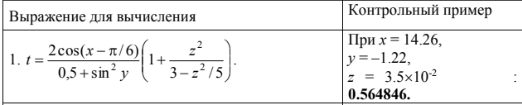
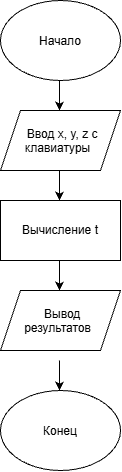

# Домашнее задание к работе 5

## Уловие задачи
Создать программу вычисления указанной величины. Результат проверить при заданных исходных значениях.

### Блок-схема

## 3. Результаты работы программы

Введите три числа: 14,26
-1,22
0,035
Результат: 0,564846

## 4. Информация о разработчике

Азиханов Дамир, бТИИ-262
